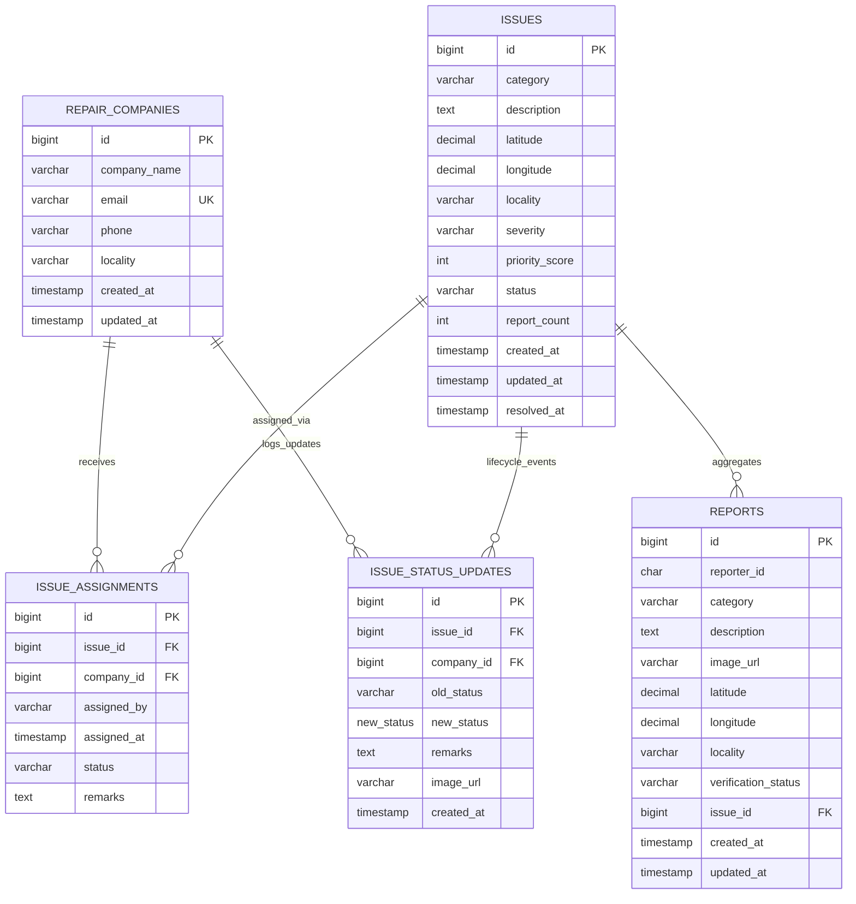

# CivicFix Database Documentation (MySQL 8)

Welcome to the **CivicFix** database schema documentation. CivicFix is an AI-powered civic issue reporting and infrastructure management platform that empowers citizens to report real-world problems (potholes, waterlogging, broken streetlights, garbage heaps, and damaged roads) while allowing municipalities and contracted repair vendors to inspect, track, and resolve them efficiently.

---

## 1. Architectural Overview & Entity-Relationship Model

The CivicFix relational database is engineered on **MySQL 8** using the **InnoDB** storage engine to guarantee full ACID compliance, foreign key integrity, and check constraint validation.

### High-Level ER Diagram



---

## 2. Table Catalog & Schema Dictionary

### 2.1. `repair_companies`
Stores verified municipal contractors, utility vendors, and public works repair agencies.

| Column | Type | Nullable | Default | Description & Constraints |
| :--- | :--- | :--- | :--- | :--- |
| `id` | `BIGINT UNSIGNED` | NO | `AUTO_INCREMENT` | **Primary Key**. Unique identifier for the repair firm. |
| `company_name` | `VARCHAR(150)` | NO | None | Official registered business name. |
| `email` | `VARCHAR(255)` | NO | None | **Unique Constraint** (`uq_repair_companies_email`). Authentication and notification email. |
| `phone` | `VARCHAR(30)` | NO | None | Direct dispatch / emergency telephone number. |
| `locality` | `VARCHAR(150)` | NO | None | Base operating jurisdiction / service zone. Indexed for geospatial filtering. |
| `created_at` | `TIMESTAMP` | NO | `CURRENT_TIMESTAMP` | Record creation timestamp. |
| `updated_at` | `TIMESTAMP` | NO | `CURRENT_TIMESTAMP ON UPDATE CURRENT_TIMESTAMP` | Last updated timestamp. |

- **Indexes**:
  - `PRIMARY KEY (id)`
  - `UNIQUE KEY uq_repair_companies_email (email)`
  - `INDEX idx_repair_companies_locality (locality)`

---

### 2.2. `issues`
Stores distinct physical civic problems in the real world. AI clustering deduplicates citizen reports so that multiple citizens complaining about the same physical pothole link to a single record in this table.

| Column | Type | Nullable | Default | Description & Constraints |
| :--- | :--- | :--- | :--- | :--- |
| `id` | `BIGINT UNSIGNED` | NO | `AUTO_INCREMENT` | **Primary Key**. Unique canonical issue identifier. |
| `category` | `VARCHAR(50)` | NO | None | **CHECK**: `category IN ('pothole', 'waterlogging', 'garbage_accumulation', 'broken_streetlight', 'drainage_problem', 'damaged_road', 'other')`. |
| `description` | `TEXT` | NO | None | Synthesized or AI-summarized problem description. |
| `latitude` | `DECIMAL(10, 8)` | NO | None | **CHECK**: `latitude BETWEEN -90.00000000 AND 90.00000000`. Precise coordinate. |
| `longitude` | `DECIMAL(11, 8)` | NO | None | **CHECK**: `longitude BETWEEN -180.00000000 AND 180.00000000`. Precise coordinate. |
| `locality` | `VARCHAR(150)` | NO | None | Locality or municipal ward name. |
| `severity` | `VARCHAR(20)` | NO | `'moderate'` | **CHECK**: `severity IN ('low', 'moderate', 'high', 'critical')`. Assigned by AI/Admin. |
| `priority_score`| `INT` | NO | `0` | **CHECK**: `priority_score >= 0`. Dynamic score combining severity and report count. |
| `status` | `VARCHAR(20)` | NO | `'reported'` | **CHECK**: `status IN ('reported', 'verified', 'assigned', 'in_progress', 'resolved', 'rejected')`. |
| `report_count` | `INT UNSIGNED` | NO | `1` | **CHECK**: `report_count >= 1`. Total citizen reports linked to this issue. |
| `created_at` | `TIMESTAMP` | NO | `CURRENT_TIMESTAMP` | Timestamp when physical issue was first identified. |
| `updated_at` | `TIMESTAMP` | NO | `CURRENT_TIMESTAMP ON UPDATE CURRENT_TIMESTAMP` | Timestamp of last modification. |
| `resolved_at` | `TIMESTAMP` | YES | `NULL` | Timestamp when verified as resolved (for SLA analytics). |

- **Indexes**:
  - `PRIMARY KEY (id)`
  - `INDEX idx_issues_status (status)`
  - `INDEX idx_issues_category (category)`
  - `INDEX idx_issues_locality (locality)`
  - `INDEX idx_issues_severity (severity)`
  - `INDEX idx_issues_priority_score (priority_score DESC)`
  - `INDEX idx_issues_coordinates (latitude, longitude)`
  - `INDEX idx_issues_category_locality (category, locality)`
  - `INDEX idx_issues_status_created_at (status, created_at)`

---

### 2.3. `reports`
Stores individual raw complaints submitted by citizens through mobile or web clients, including photographic evidence and geolocation.

| Column | Type | Nullable | Default | Description & Constraints |
| :--- | :--- | :--- | :--- | :--- |
| `id` | `BIGINT UNSIGNED` | NO | `AUTO_INCREMENT` | **Primary Key**. Unique submission identifier. |
| `reporter_id` | `CHAR(36)` | NO | None | UUID of reporting citizen (decoupled from future Auth system). |
| `category` | `VARCHAR(50)` | NO | None | **CHECK**: `category IN ('pothole', 'waterlogging', 'garbage_accumulation', 'broken_streetlight', 'drainage_problem', 'damaged_road', 'other')`. |
| `description` | `TEXT` | NO | None | Description submitted by citizen. |
| `image_url` | `VARCHAR(2048)`| NO | None | Secure storage URL of initial citizen photograph. |
| `latitude` | `DECIMAL(10, 8)` | NO | None | **CHECK**: `latitude BETWEEN -90.00000000 AND 90.00000000`. |
| `longitude` | `DECIMAL(11, 8)` | NO | None | **CHECK**: `longitude BETWEEN -180.00000000 AND 180.00000000`. |
| `locality` | `VARCHAR(150)` | NO | None | Locality as reported or reverse-geocoded. |
| `verification_status` | `VARCHAR(20)` | NO | `'pending'` | **CHECK**: `verification_status IN ('pending', 'verified', 'rejected')`. |
| `issue_id` | `BIGINT UNSIGNED`| YES | `NULL` | **Foreign Key** referencing `issues(id)`. Set once AI groups or verifies report. |
| `created_at` | `TIMESTAMP` | NO | `CURRENT_TIMESTAMP` | Report submission timestamp. |
| `updated_at` | `TIMESTAMP` | NO | `CURRENT_TIMESTAMP ON UPDATE CURRENT_TIMESTAMP` | Report update timestamp. |

- **Foreign Key**:
  - `CONSTRAINT fk_reports_issue FOREIGN KEY (issue_id) REFERENCES issues(id) ON DELETE RESTRICT ON UPDATE CASCADE`
- **Indexes**:
  - `PRIMARY KEY (id)`
  - `INDEX idx_reports_reporter_id (reporter_id)`
  - `INDEX idx_reports_issue_id (issue_id)`
  - `INDEX idx_reports_verification_status (verification_status)`
  - `INDEX idx_reports_category (category)`
  - `INDEX idx_reports_locality (locality)`
  - `INDEX idx_reports_coordinates (latitude, longitude)`
  - `INDEX idx_reports_created_at (created_at)`

---

### 2.4. `issue_assignments`
Manages work orders issued to repair companies. Supports multi-vendor workflows, contract reassignments, and audit logging.

| Column | Type | Nullable | Default | Description & Constraints |
| :--- | :--- | :--- | :--- | :--- |
| `id` | `BIGINT UNSIGNED` | NO | `AUTO_INCREMENT` | **Primary Key**. Assignment record ID. |
| `issue_id` | `BIGINT UNSIGNED` | NO | None | **Foreign Key** referencing `issues(id)`. |
| `company_id` | `BIGINT UNSIGNED` | NO | None | **Foreign Key** referencing `repair_companies(id)`. |
| `assigned_by` | `VARCHAR(100)` | NO | None | Username / UUID of municipal administrator or `'system'`. |
| `assigned_at` | `TIMESTAMP` | NO | `CURRENT_TIMESTAMP` | Assignment timestamp. |
| `status` | `VARCHAR(30)` | NO | `'assigned'` | **CHECK**: `status IN ('assigned', 'accepted', 'in_progress', 'completed', 'reassigned', 'cancelled')`. |
| `remarks` | `TEXT` | YES | `NULL` | Instructions or SLA requirements given to contractor. |

- **Foreign Keys**:
  - `CONSTRAINT fk_assignments_issue FOREIGN KEY (issue_id) REFERENCES issues(id) ON DELETE RESTRICT ON UPDATE CASCADE`
  - `CONSTRAINT fk_assignments_company FOREIGN KEY (company_id) REFERENCES repair_companies(id) ON DELETE RESTRICT ON UPDATE CASCADE`
- **Indexes**:
  - `PRIMARY KEY (id)`
  - `INDEX idx_assignments_issue_id (issue_id)`
  - `INDEX idx_assignments_company_id (company_id)`
  - `INDEX idx_assignments_company_status (company_id, status)`
  - `INDEX idx_assignments_assigned_at (assigned_at)`

---

### 2.5. `issue_status_updates`
**Append-Only Immutable Event Log**. Every status change, progress checkpoint, or resolution proof creates a new row. Rows in this table are never modified or deleted, guaranteeing an unalterable audit trail.

| Column | Type | Nullable | Default | Description & Constraints |
| :--- | :--- | :--- | :--- | :--- |
| `id` | `BIGINT UNSIGNED` | NO | `AUTO_INCREMENT` | **Primary Key**. Unique log event identifier. |
| `issue_id` | `BIGINT UNSIGNED` | NO | None | **Foreign Key** referencing `issues(id)`. |
| `company_id` | `BIGINT UNSIGNED` | YES | `NULL` | **Foreign Key** referencing `repair_companies(id)` (NULL if admin/system). |
| `old_status` | `VARCHAR(20)` | NO | None | **CHECK**: `old_status IN ('reported', 'verified', 'assigned', 'in_progress', 'resolved', 'rejected')`. |
| `new_status` | `VARCHAR(20)` | NO | None | **CHECK**: `new_status IN ('reported', 'verified', 'assigned', 'in_progress', 'resolved', 'rejected')`. |
| `remarks` | `TEXT` | YES | `NULL` | Field notes, reason for transition, or contractor remarks. |
| `image_url` | `VARCHAR(2048)`| YES | `NULL` | Progress photo or mandatory after-repair proof photograph. |
| `created_at` | `TIMESTAMP` | NO | `CURRENT_TIMESTAMP` | Timestamp of status transition. |

- **Foreign Keys**:
  - `CONSTRAINT fk_status_updates_issue FOREIGN KEY (issue_id) REFERENCES issues(id) ON DELETE RESTRICT ON UPDATE CASCADE`
  - `CONSTRAINT fk_status_updates_company FOREIGN KEY (company_id) REFERENCES repair_companies(id) ON DELETE RESTRICT ON UPDATE CASCADE`
- **Indexes**:
  - `PRIMARY KEY (id)`
  - `INDEX idx_status_updates_issue_id (issue_id)`
  - `INDEX idx_status_updates_company_id (company_id)`
  - `INDEX idx_status_updates_issue_created (issue_id, created_at)`
  - `INDEX idx_status_updates_created_at (created_at)`

---

## 3. Pre-Built Analytical Views

`schema.sql` automatically provisions four analytical views for reporting dashboards:

1. **`v_unresolved_issues`**: Real-time dispatch view of open issues (`status NOT IN ('resolved', 'rejected')`) with computed age in hours and days, locality, severity, and assigned vendor.
2. **`v_recurring_problems_by_locality`**: Identifies chronic infrastructure failure zones by aggregating problems by locality and category with total complaint volumes and critical severity ratios.
3. **`v_repair_company_performance`**: Tracks contractor KPIs, including total assigned jobs, completed jobs, completion percentages, and average resolution time in hours.
4. **`v_road_health_metrics`**: Calculates a dynamic **Road Health Score (0 to 100)** for every locality based on active road damage, unresolved waterlogging, and high-severity incidents.

---

## 4. End-to-End Civic Workflows

### Workflow A: Citizen Reporting & AI Deduplication
1. Citizen snaps a photograph and submits a complaint via the mobile app.
2. An entry is inserted into `reports` with `verification_status = 'pending'` and `issue_id = NULL`.
3. The AI Vision & Geolocation Deduplication Service:
   - Validates photograph authenticity (detects non-civic images or spam).
   - Queries `issues` within a spatial radius (e.g., 25 meters via Haversine / bounding box on `latitude, longitude`).
4. **Scenario 1 - New Problem**:
   - A new row is inserted into `issues` (`status = 'verified'`, `report_count = 1`).
   - The report is updated with `issue_id = NEW_ID` and `verification_status = 'verified'`.
   - Initial status update is logged in `issue_status_updates`.
5. **Scenario 2 - Existing Problem (Duplicate Detection)**:
   - AI detects proximity match with an existing active issue.
   - The report is updated with `issue_id = EXISTING_ID` and `verification_status = 'verified'`.
   - `issues.report_count` is incremented.
   - `issues.priority_score` is elevated to reflect higher community urgency.

### Workflow B: Repair Company Assignment
1. Municipal Dispatcher reviews verified issues on the dashboard.
2. Dispatcher selects an accredited contractor in that locality.
3. An atomic transaction creates a record in `issue_assignments`, updates `issues.status = 'assigned'`, and inserts a transition entry into `issue_status_updates`.

### Workflow C: Repair Company Execution & Photo Proof
1. Repair company logs into the vendor portal and fetches assignments (`ia.company_id = :company_id AND ia.status IN ('assigned', 'in_progress')`).
2. Crew arrives at the site and begins repair:
   - Transition to `in_progress`.
   - Optional progress photo uploaded to `issue_status_updates.image_url`.
3. Crew completes physical repair:
   - Mandatory after-repair photograph uploaded.
   - Transition to `resolved`.
   - Updates `issues.status = 'resolved'` and sets `issues.resolved_at = CURRENT_TIMESTAMP`.
   - Appends completion row into `issue_status_updates`.

### Workflow D: Historical Analysis & Infrastructure Audits
1. Urban planners run queries against historical records to detect roads requiring complete resurfacing rather than temporary patching.
2. Audit records are preserved permanently; foreign keys use `ON DELETE RESTRICT` to prevent accidental deletion of historical data.

---

## 5. Security & Data Integrity Architecture

### 5.1. Principle of Least Privilege (Database Roles)
Do not use `root` in application connection pools. Configure dedicated least-privilege users:

```sql
-- Create application user
CREATE USER 'civicfix_backend'@'%' IDENTIFIED BY 'STRONG_SECRET_PASSWORD_HERE';

-- Grant standard DML privileges (cannot drop tables or alter schema)
GRANT SELECT, INSERT, UPDATE ON civicfix_db.* TO 'civicfix_backend'@'%';

-- Create read-only analytics user for dashboards
CREATE USER 'civicfix_analyst'@'%' IDENTIFIED BY 'ANALYST_PASSWORD_HERE';
GRANT SELECT ON civicfix_db.* TO 'civicfix_analyst'@'%';

FLUSH PRIVILEGES;
```

### 5.2. Backend Authorization Boundaries
To prevent security vulnerabilities:
- **Repair Companies Cannot Modify Administrative Fields**:
  - The backend API must reject any request from a repair company attempting to alter `severity`, `priority_score`, `category`, `locality`, or `verification_status`.
  - Repair companies may ONLY alter `status`, `remarks`, and attach `image_url` on work orders specifically assigned to them.
- **Tenant & Contractor Isolation**:
  - Every vendor request must be authenticated with a JWT or session bearing `company_id`.
  - All vendor queries must enforce `WHERE ia.company_id = :session_company_id`.
- **Append-Only Status Updates**:
  - Revoke `UPDATE` and `DELETE` privileges on `issue_status_updates` for the operational application role if desired, or enforce via application layer that only `INSERT` queries target this table.

### 5.3. Safe Credential Management
- Store database credentials in environment variables or cloud secret managers (e.g., AWS Secrets Manager, GCP Secret Manager, or a local `.env` file).
- Add `.env` to `.gitignore`. Never commit plaintext passwords.

---

## 6. How to Execute SQL Files Using MySQL Workbench

### Prerequisites
- MySQL Community Server 8.0+ installed and running.
- MySQL Workbench 8.0+ installed.

### Step-by-Step Execution Guide

1. **Launch MySQL Workbench**:
   - Open MySQL Workbench and click on your target MySQL Local Instance (default: `localhost:3306`).
   - Enter your root/admin password when prompted.

2. **Execute `schema.sql`**:
   - In the top menu, go to **File** -> **Open SQL Script...** (or press `Ctrl + Shift + O`).
   - Browse to `database/schema.sql` and click **Open**.
   - Review the SQL script in the editor tab.
   - Click the **Execute (Lightning Bolt)** icon or press `Ctrl + Shift + Enter`.
   - Inspect the **Action Output** pane at the bottom. Verify that all 5 tables (`repair_companies`, `issues`, `reports`, `issue_assignments`, `issue_status_updates`) and 4 analytical views were created with green checkmarks.
   - In the left sidebar under **Schemas**, right-click and choose **Refresh All**; expand `civicfix_db` to verify the table hierarchy.

3. **Execute `test_queries.sql`**:
   - Go to **File** -> **Open SQL Script...** and select `database/test_queries.sql`.
   - Click the **Execute (Lightning Bolt)** icon.
   - Observe the result grids demonstrating citizen report ingestion, AI issue deduplication, work order assignment, multi-stage status updates, and analytical aggregations.

---

## 7. Backend Integration Guide

### 7.1. Node.js / TypeScript Example (`mysql2/promise`)

Install the recommended MySQL2 driver:
```bash
npm install mysql2 dotenv
```

Configuration via environment variables (`.env`):
```env
DB_HOST=127.0.0.1
DB_PORT=3306
DB_USER=civicfix_backend
DB_PASSWORD=your_secure_password
DB_NAME=civicfix_db
DB_CONNECTION_LIMIT=10
```

Database connection pool (`db.ts`):
```typescript
import mysql from 'mysql2/promise';
import dotenv from 'dotenv';

dotenv.config();

export const pool = mysql.createPool({
  host: process.env.DB_HOST || '127.0.0.1',
  port: Number(process.env.DB_PORT) || 3306,
  user: process.env.DB_USER,
  password: process.env.DB_PASSWORD,
  database: process.env.DB_NAME,
  waitForConnections: true,
  connectionLimit: Number(process.env.DB_CONNECTION_LIMIT) || 10,
  queueLimit: 0,
  timezone: '+00:00', // UTC
  decimalNumbers: true // Return coordinates as numeric decimals
});

// Example Transactional Service: Contractor updates status with proof photo
export async function updateIssueProgress(
  issueId: number,
  companyId: number,
  oldStatus: string,
  newStatus: string,
  remarks: string,
  imageUrl: string
) {
  const connection = await pool.getConnection();
  try {
    await connection.beginTransaction();

    // 1. Verify authorization: Ensure issue is currently assigned to this company
    const [rows]: any = await connection.execute(
      `SELECT id FROM issue_assignments 
       WHERE issue_id = ? AND company_id = ? AND status IN ('assigned', 'in_progress')`,
      [issueId, companyId]
    );

    if (rows.length === 0) {
      throw new Error('Unauthorized: Company is not assigned to this issue');
    }

    // 2. Update issue master record
    const resolvedAtClause = newStatus === 'resolved' ? ', resolved_at = NOW()' : '';
    await connection.execute(
      `UPDATE issues SET status = ?, updated_at = NOW() ${resolvedAtClause} WHERE id = ?`,
      [newStatus, issueId]
    );

    // 3. Update assignment state
    const assignmentStatus = newStatus === 'resolved' ? 'completed' : newStatus;
    await connection.execute(
      `UPDATE issue_assignments SET status = ? WHERE issue_id = ? AND company_id = ?`,
      [assignmentStatus, issueId, companyId]
    );

    // 4. Append to immutable audit log
    await connection.execute(
      `INSERT INTO issue_status_updates 
       (issue_id, company_id, old_status, new_status, remarks, image_url)
       VALUES (?, ?, ?, ?, ?, ?)`,
      [issueId, companyId, oldStatus, newStatus, remarks, imageUrl]
    );

    await connection.commit();
    return { success: true, message: 'Status updated successfully' };
  } catch (error) {
    await connection.rollback();
    throw error;
  } finally {
    connection.release();
  }
}
```

---

### 7.2. Python / FastAPI Example (`SQLAlchemy` or `aiomysql`)

Install async database drivers:
```bash
pip install pymysql cryptography sqlalchemy
```

Configuration and connection manager (`database.py`):
```python
import os
from sqlalchemy import create_engine
from sqlalchemy.orm import sessionmaker

DB_USER = os.getenv("DB_USER", "civicfix_backend")
DB_PASSWORD = os.getenv("DB_PASSWORD", "your_secure_password")
DB_HOST = os.getenv("DB_HOST", "127.0.0.1")
DB_PORT = os.getenv("DB_PORT", "3306")
DB_NAME = os.getenv("DB_NAME", "civicfix_db")

DATABASE_URL = f"mysql+pymysql://{DB_USER}:{DB_PASSWORD}@{DB_HOST}:{DB_PORT}/{DB_NAME}?charset=utf8mb4"

engine = create_engine(
    DATABASE_URL,
    pool_size=10,
    max_overflow=20,
    pool_recycle=3600,
    pool_pre_ping=True
)

SessionLocal = sessionmaker(autocommit=False, autoflush=False, bind=engine)

def get_db():
    db = SessionLocal()
    try:
        yield db
    finally:
        db.close()
```

---

## 8. Summary of Design Decisions & Best Practices

1. **High Precision Coordinates**: Latitude uses `DECIMAL(10, 8)` and Longitude uses `DECIMAL(11, 8)`. This gives sub-millimeter precision, critical for pinpointing individual potholes on multi-lane highways.
2. **Data Integrity via CHECK Constraints**: All categorical statuses and ranges are guarded at the database level with native MySQL 8 `CHECK` constraints, preventing corrupt state entries regardless of client or application bugs.
3. **Decoupled User Authentication**: `reporter_id` uses `CHAR(36)` to support UUIDv4 identifiers from external Identity Providers (such as Firebase Auth, Supabase Auth, Keycloak, or Auth0) without introducing brittle foreign key dependencies.
4. **Referential Safety**: All primary-foreign relationships use `ON DELETE RESTRICT ON UPDATE CASCADE`, ensuring that historical civic issues, audit logs, and company assignments are never accidentally purged.
5. **Full Audit Traceability**: The `issue_status_updates` table guarantees an immutable, linear record of every single lifecycle transition from initial citizen submission to contractor sign-off.
