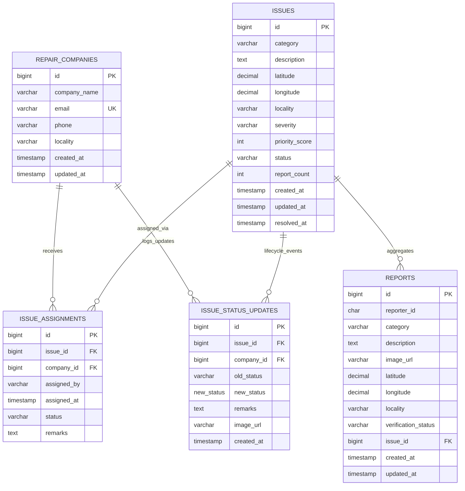

# CivicFix Database Documentation (MySQL 8)

Welcome to the **CivicFix** database schema documentation. CivicFix is an AI-powered civic issue reporting and infrastructure management platform that empowers citizens to report real-world problems (potholes, waterlogging, broken streetlights, garbage heaps, and damaged roads) while allowing municipalities and contracted repair vendors to inspect, track, and resolve them efficiently.

---

## 1. Architectural Overview & Entity-Relationship Model

The CivicFix relational database is engineered on **MySQL 8** using the **InnoDB** storage engine to guarantee full ACID compliance, foreign key integrity, and check constraint validation.

### High-Level ER Diagram

---

## 2. Table Catalog & Schema Dictionary

### 2.1. `repair_companies`
Stores verified municipal contractors, utility vendors, and public works repair agencies.

| Column | Type | Nullable | Default | Description & Constraints |
| :--- | :--- | :--- | :--- | :--- |
| `id` | `BIGINT UNSIGNED` | NO | `AUTO_INCREMENT` | **Primary Key**. Unique identifier for the repair firm. |
| `company_name` | `VARCHAR(150)` | NO | None | Official registered business name. |
| `email` | `VARCHAR(255)` | NO | None | **Unique Constraint** (`uq_repair_companies_email`). Authentication and notification email. |
| `phone` | `VARCHAR(30)` | NO | None | Direct dispatch / emergency telephone number. |
| `locality` | `VARCHAR(150)` | NO | None | Base operating jurisdiction / service zone. Indexed for geospatial filtering. |
| `created_at` | `TIMESTAMP` | NO | `CURRENT_TIMESTAMP` | Record creation timestamp. |
| `updated_at` | `TIMESTAMP` | NO | `CURRENT_TIMESTAMP ON UPDATE CURRENT_TIMESTAMP` | Last updated timestamp. |

- **Indexes**:
  - `PRIMARY KEY (id)`
  - `UNIQUE KEY uq_repair_companies_email (email)`
  - `INDEX idx_repair_companies_locality (locality)`

---

### 2.2. `issues`
Stores distinct physical civic problems in the real world. AI clustering deduplicates citizen reports so that multiple citizens complaining about the same physical pothole link to a single record in this table.

| Column | Type | Nullable | Default | Description & Constraints |
| :--- | :--- | :--- | :--- | :--- |
| `id` | `BIGINT UNSIGNED` | NO | `AUTO_INCREMENT` | **Primary Key**. Unique canonical issue identifier. |
| `category` | `VARCHAR(50)` | NO | None | **CHECK**: `category IN ('pothole', 'waterlogging', 'garbage_accumulation', 'broken_streetlight', 'drainage_problem', 'damaged_road', 'other')`. |
| `description` | `TEXT` | NO | None | Synthesized or AI-summarized problem description. |
| `latitude` | `DECIMAL(10, 8)` | NO | None | **CHECK**: `latitude BETWEEN -90.00000000 AND 90.00000000`. Precise coordinate. |
| `longitude` | `DECIMAL(11, 8)` | NO | None | **CHECK**: `longitude BETWEEN -180.00000000 AND 180.00000000`. Precise coordinate. |
| `locality` | `VARCHAR(150)` | NO | None | Locality or municipal ward name. |
| `severity` | `VARCHAR(20)` | NO | `'moderate'` | **CHECK**: `severity IN ('low', 'moderate', 'high', 'critical')`. Assigned by AI/Admin. |
| `priority_score`| `INT` | NO | `0` | **CHECK**: `priority_score >= 0`. Dynamic score combining severity and report count. |
| `status` | `VARCHAR(20)` | NO | `'reported'` | **CHECK**: `status IN ('reported', 'verified', 'assigned', 'in_progress', 'resolved', 'rejected')`. |
| `report_count` | `INT UNSIGNED` | NO | `1` | **CHECK**: `report_count >= 1`. Total citizen reports linked to this issue. |
| `created_at` | `TIMESTAMP` | NO | `CURRENT_TIMESTAMP` | Timestamp when physical issue was first identified. |
| `updated_at` | `TIMESTAMP` | NO | `CURRENT_TIMESTAMP ON UPDATE CURRENT_TIMESTAMP` | Timestamp of last modification. |
| `resolved_at` | `TIMESTAMP` | YES | `NULL` | Timestamp when verified as resolved (for SLA analytics). |

- **Indexes**:
  - `PRIMARY KEY (id)`
  - `INDEX idx_issues_status (status)`
  - `INDEX idx_issues_category (category)`
  - `INDEX idx_issues_locality (locality)`
  - `INDEX idx_issues_severity (severity)`
  - `INDEX idx_issues_priority_score (priority_score DESC)`
  - `INDEX idx_issues_coordinates (latitude, longitude)`
  - `INDEX idx_issues_category_locality (category, locality)`
  - `INDEX idx_issues_status_created_at (status, created_at)`

---

### 2.3. `reports`
Stores individual raw complaints submitted by citizens through mobile or web clients, including photographic evidence and geolocation.

| Column | Type | Nullable | Default | Description & Constraints |
| :--- | :--- | :--- | :--- | :--- |
| `id` | `BIGINT UNSIGNED` | NO | `AUTO_INCREMENT` | **Primary Key**. Unique submission identifier. |
| `reporter_id` | `CHAR(36)` | NO | None | UUID of reporting citizen (decoupled from future Auth system). |
| `category` | `VARCHAR(50)` | NO | None | **CHECK**: `category IN ('pothole', 'waterlogging', 'garbage_accumulation', 'broken_streetlight', 'drainage_problem', 'damaged_road', 'other')`. |
| `description` | `TEXT` | NO | None | Description submitted by citizen. |
| `image_url` | `VARCHAR(2048)`| NO | None | Secure storage URL of initial citizen photograph. |
| `latitude` | `DECIMAL(10, 8)` | NO | None | **CHECK**: `latitude BETWEEN -90.00000000 AND 90.00000000`. |
| `longitude` | `DECIMAL(11, 8)` | NO | None | **CHECK**: `longitude BETWEEN -180.00000000 AND 180.00000000`. |
| `locality` | `VARCHAR(150)` | NO | None | Locality as reported or reverse-geocoded. |
| `verification_status` | `VARCHAR(20)` | NO | `'pending'` | **CHECK**: `verification_status IN ('pending', 'verified', 'rejected')`. |
| `issue_id` | `BIGINT UNSIGNED`| YES | `NULL` | **Foreign Key** referencing `issues(id)`. Set once AI groups or verifies report. |
| `created_at` | `TIMESTAMP` | NO | `CURRENT_TIMESTAMP` | Report submission timestamp. |
| `updated_at` | `TIMESTAMP` | NO | `CURRENT_TIMESTAMP ON UPDATE CURRENT_TIMESTAMP` | Report update timestamp. |

- **Foreign Key**:
  - `CONSTRAINT fk_reports_issue FOREIGN KEY (issue_id) REFERENCES issues(id) ON DELETE RESTRICT ON UPDATE CASCADE`
- **Indexes**:
  - `PRIMARY KEY (id)`
  - `INDEX idx_reports_reporter_id (reporter_id)`
  - `INDEX idx_reports_issue_id (issue_id)`
  - `INDEX idx_reports_verification_status (verification_status)`
  - `INDEX idx_reports_category (category)`
  - `INDEX idx_reports_locality (locality)`
  - `INDEX idx_reports_coordinates (latitude, longitude)`
  - `INDEX idx_reports_created_at (created_at)`

---

### 2.4. `issue_assignments`
Manages work orders issued to repair companies. Supports multi-vendor workflows, contract reassignments, and audit logging.

| Column | Type | Nullable | Default | Description & Constraints |
| :--- | :--- | :--- | :--- | :--- |
| `id` | `BIGINT UNSIGNED` | NO | `AUTO_INCREMENT` | **Primary Key**. Assignment record ID. |
| `issue_id` | `BIGINT UNSIGNED` | NO | None | **Foreign Key** referencing `issues(id)`. |
| `company_id` | `BIGINT UNSIGNED` | NO | None | **Foreign Key** referencing `repair_companies(id)`. |
| `assigned_by` | `VARCHAR(100)` | NO | None | Username / UUID of municipal administrator or `'system'`. |
| `assigned_at` | `TIMESTAMP` | NO | `CURRENT_TIMESTAMP` | Assignment timestamp. |
| `status` | `VARCHAR(30)` | NO | `'assigned'` | **CHECK**: `status IN ('assigned', 'accepted', 'in_progress', 'completed', 'reassigned', 'cancelled')`. |
| `remarks` | `TEXT` | YES | `NULL` | Instructions or SLA requirements given to contractor. |

- **Foreign Keys**:
  - `CONSTRAINT fk_assignments_issue FOREIGN KEY (issue_id) REFERENCES issues(id) ON DELETE RESTRICT ON UPDATE CASCADE`
  - `CONSTRAINT fk_assignments_company FOREIGN KEY (company_id) REFERENCES repair_companies(id) ON DELETE RESTRICT ON UPDATE CASCADE`
- **Indexes**:
  - `PRIMARY KEY (id)`
  - `INDEX idx_assignments_issue_id (issue_id)`
  - `INDEX idx_assignments_company_id (company_id)`
  - `INDEX idx_assignments_company_status (company_id, status)`
  - `INDEX idx_assignments_assigned_at (assigned_at)`

---

### 2.5. `issue_status_updates`
**Append-Only Immutable Event Log**. Every status change, progress checkpoint, or resolution proof creates a new row. Rows in this table are never modified or deleted, guaranteeing an unalterable audit trail.

| Column | Type | Nullable | Default | Description & Constraints |
| :--- | :--- | :--- | :--- | :--- |
| `id` | `BIGINT UNSIGNED` | NO | `AUTO_INCREMENT` | **Primary Key**. Unique log event identifier. |
| `issue_id` | `BIGINT UNSIGNED` | NO | None | **Foreign Key** referencing `issues(id)`. |
| `company_id` | `BIGINT UNSIGNED` | YES | `NULL` | **Foreign Key** referencing `repair_companies(id)` (NULL if admin/system). |
| `old_status` | `VARCHAR(20)` | NO | None | **CHECK**: `old_status IN ('reported', 'verified', 'assigned', 'in_progress', 'resolved', 'rejected')`. |
| `new_status` | `VARCHAR(20)` | NO | None | **CHECK**: `new_status IN ('reported', 'verified', 'assigned', 'in_progress', 'resolved', 'rejected')`. |
| `remarks` | `TEXT` | YES | `NULL` | Field notes, reason for transition, or contractor remarks. |
| `image_url` | `VARCHAR(2048)`| YES | `NULL` | Progress photo or mandatory after-repair proof photograph. |
| `created_at` | `TIMESTAMP` | NO | `CURRENT_TIMESTAMP` | Timestamp of status transition. |

- **Foreign Keys**:
  - `CONSTRAINT fk_status_updates_issue FOREIGN KEY (issue_id) REFERENCES issues(id) ON DELETE RESTRICT ON UPDATE CASCADE`
  - `CONSTRAINT fk_status_updates_company FOREIGN KEY (company_id) REFERENCES repair_companies(id) ON DELETE RESTRICT ON UPDATE CASCADE`
- **Indexes**:
  - `PRIMARY KEY (id)`
  - `INDEX idx_status_updates_issue_id (issue_id)`
  - `INDEX idx_status_updates_company_id (company_id)`
  - `INDEX idx_status_updates_issue_created (issue_id, created_at)`
  - `INDEX idx_status_updates_created_at (created_at)`

---

## 3. Pre-Built Analytical Views

`schema.sql` automatically provisions four analytical views for reporting dashboards:

1. **`v_unresolved_issues`**: Real-time dispatch view of open issues (`status NOT IN ('resolved', 'rejected')`) with computed age in hours and days, locality, severity, and assigned vendor.
2. **`v_recurring_problems_by_locality`**: Identifies chronic infrastructure failure zones by aggregating problems by locality and category with total complaint volumes and critical severity ratios.
3. **`v_repair_company_performance`**: Tracks contractor KPIs, including total assigned jobs, completed jobs, completion percentages, and average resolution time in hours.
4. **`v_road_health_metrics`**: Calculates a dynamic **Road Health Score (0 to 100)** for every locality based on active road damage, unresolved waterlogging, and high-severity incidents.
